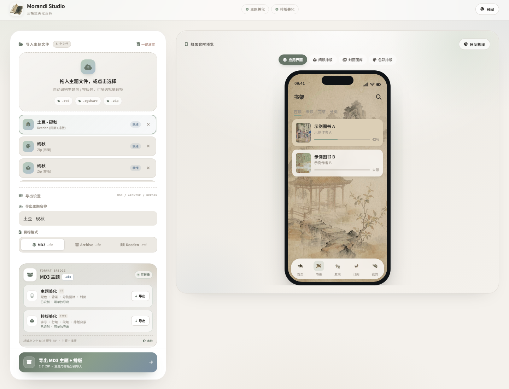

# 🎨 Morandi Theme Studio — 三格式美化互转

一个纯前端、离线运行的 **Reeden / Archive / MD3 美化转换器**。读取三种软件的真实主题包结构，按目标软件的原生格式重新打包，而不是简单改后缀。



---

## 📦 三种软件的真实格式

| 软件 | 主题美化 | 排版美化 | 容器 |
| --- | --- | --- | --- |
| **MD3** | `manifest.json` + `assets/` + `cover-albums/` | `readConfig.json` + 背景图 | `.zip` |
| **Archive** | `appearance_kit.json` + `theme_day.zip` / `theme_night.zip` / `top_bar_*.zip` / `navigation_bar_day.zip` / `cover_collection_day.zip` | `readConfig.json` + 背景图 | `.zip` |
| **Reeden** | `theme.json` + `light/theme_bg.img` + `navbar_pack/` + `cover_gallery/` + `reader_schema/` | 同左，排版在 `reader_schema/<id>/schema.json` | `.red`（`RED\x04` + ZIP） |

> MD3 与 Archive 的主题、排版是分开导入的；Reeden 的一个 `.red` 同时包含主题与排版。

Reeden `.red` 有两种真实容器：

- `RED\x04` + ZIP：按 ZIP 内 `theme.json` / `reader_schema/` 读取；
- `RED\x10` 二进制：头部是 JSON，manifest 加密，资源为明文顺序流。工具会解析明文 `theme.json`、reader schema，并用 schema 里的 **MD5** 匹配 `light/theme_bg.img` / `dark/theme_bg.img` / 排版背景，避免把封面或 UI 背景误当成阅读背景。

---

## 🔁 支持的转换方向

- Reeden → MD3
- Reeden → Archive
- Archive → MD3
- Archive → Reeden
- MD3 → Archive
- MD3 → Reeden
- 各格式内部重新导出（会按原格式重建，不丢基础结构）

### 主题与排版分开的软件

MD3 / Archive 的输入通常是两个文件：一个主题包、一个排版包。把它们一起拖进队列即可：

- 选中主题包，导出时会自动寻找队列中同名的排版包；
- 选中排版包，也会反向寻找主题包；
- 找不到时会提示缺失模块，不会拿另一个软件的 `readConfig` 硬套。

Reeden 输出为单个 `.red`，会同时写入主题、导航图标、封面和 `reader_schema`。

---

## ✨ 界面

- 三目标格式切换：**MD3 / Archive / Reeden**
- **排版校准预览**：阅读预览按源格式的 `paddingTop / headerPadding / titleTop / footer` 渲染，自动检测背景图像焦点并显示参考线；可分别校准页眉位置、页脚位置、标题间距、正文上边距、正文下边距，并编辑页眉/页脚左中右信息模板（支持 `{ChapterTitle}` `{BookName}` `{Time}` `{PageIndex}` `{PageSize}` 等占位符）。校准会写入导出的 MD3 / Archive 排版字段；自定义页眉页脚对应 MD3 的 `tipHeader*=18 / customTipHeader*`
- **转 Red 独立双文件打包**：选择 Reeden 后会出现「主题来源 / 排版来源」两个下拉框，可分别选择任意已导入的 Arc / MD3 / Reeden 文件，再合并成一个 `.red`；不再依赖当前只选中一个文件去猜配对
- 主题美化、排版美化分别显示识别状态与队列配对来源
- 一键导出主题 + 排版（MD3 / Archive 为两个原生 ZIP，Reeden 为一个 `.red`）
- 深色 / 浅色主题、移动端适配、本地文件不上传
- Font Awesome 已本地化，运行时不请求 CDN

### 排版字段映射（重点）

- Reeden → MD3：`paddingTop` 取 Reeden 的 `headerPaddingBottom`；`paddingBottom = footerPaddingTop + footerPaddingBottom - 6`；`lineSpacingExtra = lineSpacing - 2`；`paragraphSpacing` 按字号归一；`titleSize = round(fontSize × 1.3)`；`titleBottomSpacing = titlePaddingBottom + 9`。
- Reeden `paragraphIndent: "double"` 会转换为 MD3 / Archive 的两个全角空格，而不是原样写入字符串。
- MD3 ↔ Archive 的 `titleSize`、`titleMode`、`paddingTop` 按各自单位换算，不再混用；Archive 输出避免使用需要额外 Lottie 资源的 `titleMode 3`。
- Reeden 输出使用 Reeden 自己的 `-1 / defaults` 自动行距、段距、字距。
- Reeden → Reeden 会保留原始 `theme.json` 的 alpha 颜色和额外字段，写入日/夜两套 `reader_schema` 与两张 `bg.img`，封面按真实格式（PNG/JPEG）命名；不再只写一套 schema。
- Archive APK 的 `titleSize` 是**相对正文字号的增量**（`titlePx = textSize + titleSize`），导出时写入增量而不是绝对字号。
- 排版背景图导出时按内容 MD5 生成唯一文件名（如 `bg_f9a37d5788f0db29.jpg`），避免目标软件 `files/bg/` 里已有同名 `bg_reader.jpg` 时不覆盖旧图，导致“网页预览对、导入后背景不对”。

---

## 🚀 使用

直接双击 `Morandi-Archive-Studio.html`（单文件离线版），或启动本地静态服务器：

```powershell
cd md-theme
python -m http.server 8765
```

然后打开 `http://127.0.0.1:8765/`。

---

## 🛠 重新生成单文件网页

```powershell
cd md-theme
python build_standalone.py "Morandi-Archive-Studio.html"
```

`build_standalone.py` 会把 CSS、JS、JSZip、Font Awesome 字体和 Logo 全部内嵌。

---

## 🧪 已验证

使用真实样例包验证：

- `应用主题 - 土豆 - 砚秋.red` → MD3 主题 + 排版
- `应用主题 - 土豆 - 砚秋.red` → Archive 主题 + 排版
- `砚秋arc主题.zip` + `砚秋arc排版.zip` → MD3
- `砚秋MD3主题包.zip` + `MD3排版砚秋.zip` → Archive
- 双向 → Reeden `.red`（含 `RED\x04` 头、`theme.json`、`navbar_pack`、`cover_gallery`、`reader_schema`）
- 生成物可被本工具重新解析，Archive 嵌套包、Reeden `.red` 均可回读

---

## 📄 开源许可

© 2026 Morandi Theme Studio. MIT License.

本地图标来自 [Font Awesome Free 6.5.0](https://fontawesome.com/)：图标 CC BY 4.0，字体 SIL OFL 1.1，代码 MIT。
